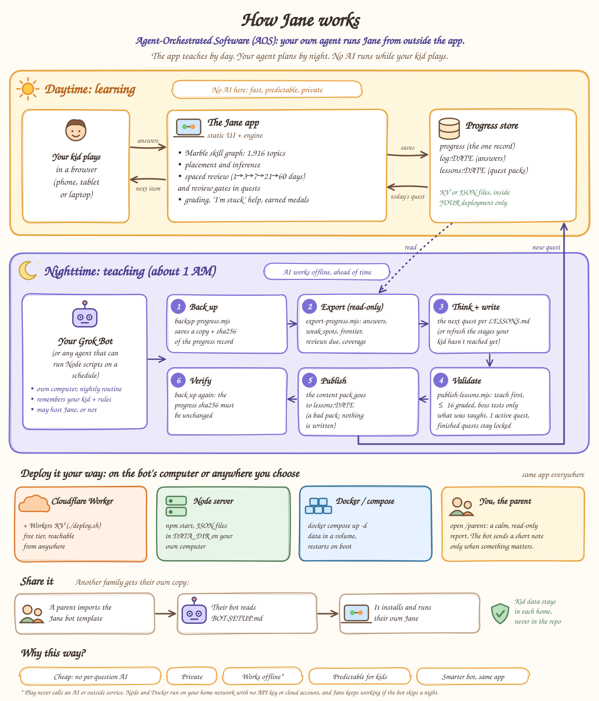
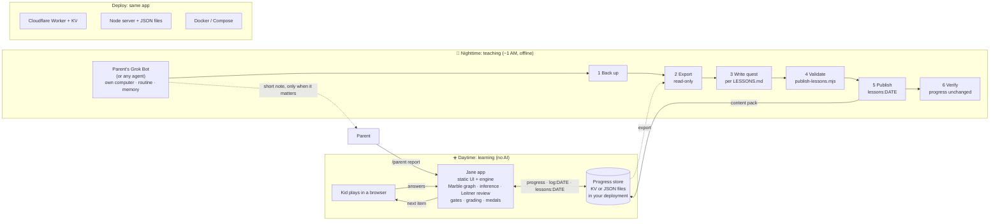

# How Jane works: an app with no AI inside, and a bot that teaches at night

The short version: **the app your kid uses has no AI in it.** Its own code grades answers, schedules reviews and
plays the current quest. The "brain" that adapts the lessons is an AI assistant bot (in Kent's house, **Grok
Bot**) that works **offline, once a night**: it reads how your kid did, writes the next quest, and hands it to the app
through a validator. The bot can get smarter over time without the app changing at all. The bot may also host the
app, but it doesn't have to.

## Agent-Orchestrated Software (AOS)
Kent's name for this way of building and sharing software:

> **Agent-Orchestrated Software (AOS):** software whose adaptation, content, and upkeep are orchestrated by the user's
> own AI agent, working from outside the app. The agent may host the app, but doesn't have to. The app can include AI
> of its own, but doesn't need to.

**Jane is an example.** Jane happens to have no AI inside. The parent's own agent (Grok Bot, or any agent that can run
Node scripts on a schedule) reads the day's progress and writes the next quest offline each night, then publishes it
through the app's validator. The agent may also host Jane on its own computer, or Jane can run somewhere the parent
chooses (Cloudflare, a home computer, Docker) while the agent just does the nightly work.

| | AOS | SaaS | Traditional installed software |
|---|---|---|---|
| **Where it runs** | Wherever you choose: your agent's computer, your own machine or a cloud account you own | The vendor's servers | Your own device |
| **Who adapts and improves it** | Your own AI agent, from outside the app (the code's authors still ship updates) | The vendor, the same for everyone | The vendor, through new versions |
| **Where the data lives** | In your own deployment | On the vendor's servers | On your device |
| **How it's distributed** | Open code plus an agent template or recipe (here: [BOT-SETUP.md](../BOT-SETUP.md)) | Sign up for an account | Installer, download or app store |
| **Cost model** | Your hosting (often a free tier) plus the agent you already use | Subscription, per seat or ads | One-time purchase or license |

## The parts

### ☀️ Daytime: learning (no AI)
- **Your kid plays in a browser** on a phone, tablet or laptop. Answers go to the app; the next question, hints and
  medals come back.
- **The Jane app** is static files ([`public/`](../public)) plus the engine ([`src/engine.js`](../src/engine.js)),
  served by [`src/worker.js`](../src/worker.js). It runs on the open
  [Marble Skill Taxonomy](https://github.com/withmarbleapp/os-taxonomy): 1,590 topics linked by prerequisites. With
  that graph it places the kid, infers skills from harder ones they got right, schedules spaced review in Leitner boxes
  (1 → 3 → 7 → 21 → 60 days), runs 🗝️ review gates inside quests, grades answers (including the "I'm stuck" hint →
  worked example → skip help) and awards medals that have to be earned. Every rule is written down in the code, so
  the same answers always lead to the same behavior.
- **The progress store** holds three kinds of keys: `progress` (the kid's one record), `log:DATE` (that day's answers)
  and `lessons:DATE` (quest packs). It is Workers KV on Cloudflare, or one JSON file per key in `DATA_DIR` on Node and
  Docker. It lives only in your own deployment.

### 🌙 Nighttime: teaching (AI, offline)
Around 1 AM a scheduled routine on the bot's own computer runs the cycle in [NIGHTLY.md](NIGHTLY.md):
1. **Back up** with [`backup-progress.mjs`](../backup-progress.mjs), which prints a sha256 of the progress record.
2. **Export** with [`export-progress.mjs`](../export-progress.mjs) (read-only): the day's answers, weak spots, the
   frontier of ready topics, reviews due, coverage of subject areas, and whether a quest is in progress.
3. **Think and write.** The bot reads the export and writes the next quest following [LESSONS.md](../LESSONS.md),
   or, if a quest is in progress, rewrites only the stages the kid hasn't reached yet.
4. **Validate** with [`publish-lessons.mjs`](../publish-lessons.mjs). It fails a pack that breaks the rules: teach
   before testing, at most 16 graded questions, a boss that only tests what the quest taught, one active quest at a
   time, finished quests locked. An invalid pack writes nothing.
5. **Publish** the content pack to `lessons:DATE`. In the morning the kid finds a new quest, or fresh stages ahead.
6. **Verify** with a second backup: the progress sha256 must be unchanged.

The bot remembers your kid and your rules between nights, and it messages you only when something matters (a failure,
review not keeping up, a struggle that keeps coming back, a milestone). Setting it up: [BOT-SETUP.md](../BOT-SETUP.md).

### 🚀 Deploy it your way
The same code runs everywhere ([INSTALL.md](../INSTALL.md)):
- **Cloudflare Worker + Workers KV** (`./deploy.sh`): free tier, reachable from anywhere.
- **Standalone Node server** (`npm start`): JSON files in `DATA_DIR` on your own computer.
- **Docker / Compose** (`docker compose up -d`): data in a volume, restarts on boot, on your home network.

You, the parent, open **`/parent`**: a calm, read-only report of progress, quests, reviews and the answer log.

### 🤝 Share it
Another family imports the [Jane bot template](../README.md#set-up-with-an-ai-bot), their bot reads [BOT-SETUP.md](../BOT-SETUP.md) and installs **their
own copy**. Each family's kid data stays in their own deployment and is never committed to the repo (it's all
gitignored; see [CONTRIBUTING.md](../CONTRIBUTING.md)).

## The principle: no runtime AI
The AI is an **author**, not a **chatbot**. It writes content ahead of time; the app shows only content that was
written and checked before the kid saw it. That makes Jane:
- **Cheap:** no per-question AI calls. It runs on a free-tier Worker or any computer with Node 22.
- **Private:** the kid's answers stay in your storage, and no model sees them while they play.
- **Works offline:** play never calls an AI or outside service, and Jane keeps working if the bot skips a night (it
  falls back to its built-in questions, generators and reviews).
- **Predictable for kids:** Jane can only say what's already written and validated. No surprises, no off-topic chats.
- **Smarter bot, same app:** when the bot (or its model) improves, the quests improve. The app doesn't change.

## Text version (Mermaid)

## FAQ
**Is the AI talking to my kid?**
No. Nothing in the app calls a model. Every question, hint, card and line Jane says was written ahead of time (by
people, by the build from the taxonomy, or by the bot at night) and checked by a validator before your kid could see it.

**Where does my kid's data live?**
Only in your own deployment: your Cloudflare account's KV, or the `DATA_DIR` folder or Docker volume on your
computer. Exports and backups the bot makes stay on its computer, in gitignored folders. Nothing is sent to this repo.
The nightly bot does read the export to write the next quest, so pick a bot you trust with it.

**Can I use another bot or agent instead of Grok Bot?**
Yes. Any agent that can run Node scripts on a schedule can follow [BOT-SETUP.md](../BOT-SETUP.md). You can also be
the author yourself: export, write a pack by hand, validate, publish ([NIGHTLY.md → Run it yourself](NIGHTLY.md#run-it-yourself)).

**What if the bot skips a night?**
Jane keeps working. The current quest stays, and the app falls back to its built-in diagnostics, math generators,
kid questions and spaced reviews.

**Could the bot publish something broken or unkind?**
`publish-lessons.mjs` rejects packs that break the rules (formats, size, teach-first, fair bosses, one active quest)
and warns on the rest (for example wording that doesn't talk to the kid as "you"). It never overwrites a finished quest. Every pack is also a plain JSON file you can read.

---
The diagram is generated by [`architecture.mjs`](architecture.mjs) (`KALAM_DIR=<folder with the Kalam TTFs> node
docs/architecture.mjs` embeds a subset of the [Kalam](https://fonts.google.com/specimen/Kalam) font, SIL Open Font
License 1.1). This page is project documentation under CC BY-SA 4.0 (see [LICENSING.md](../LICENSING.md)).
