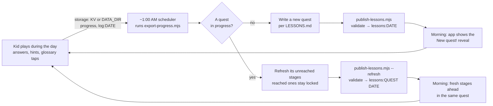

# How the nightly cycle works

Every night, a lesson author reads the day's results and writes tomorrow's quest. In Kent's household that author is
**Grok Bot**, an AI assistant, running as a scheduled routine. **The app doesn't depend on Grok Bot or any outside
service.** The interface is two scripts, [`export-progress.mjs`](../export-progress.mjs) and
[`publish-lessons.mjs`](../publish-lessons.mjs), plus the rules in [LESSONS.md](../LESSONS.md). Anyone can run the cycle
on whatever scheduler they like, and write the pack by hand or with any assistant.



> **Offline authoring, never live AI.** The nightly author (a person, Grok Bot or any assistant) works *ahead of
> time*. What it writes is validated by `publish-lessons.mjs` before the app can show it, and the app itself never calls
> a model while the kid plays. See [README → Philosophy](../README.md#philosophy).

> **Several kids?** The cycle runs once per learner: `export-progress.mjs --learner <id>` → one quest at that kid's
> level → `publish-lessons.mjs <pack> --learner <id>`. Without `--learner` both scripts act on the primary learner, as
> they always did. See [LESSONS.md → Several learners](../LESSONS.md#several-learners-profiles).

## 1. Schedule (about 1:00 AM local time)
The routine runs once a night, around **1:00 AM local time**, after the kid's day is over and before the next one starts.
Dates are Pacific Time days (`ptDate` in the code). In this deployment a scheduled Grok Bot routine runs it. For your
own install, use any scheduler (see [Run it yourself](#run-it-yourself)).

## 2. Export the day (read-only)
```bash
node export-progress.mjs          # → exports/progress-<PT date>.json (gitignored: it contains the child's data)
```
The export includes:
- **`learner`**: name, target age and grade from `wrangler.toml` `[vars]` (or the `LEARNER_*` env vars with `--local`).
- **`todayLog`**: every answer of the day, plus mastered, inferred and demoted events.
- **`weakSpots`** (last 7 days, `--days N`): first-try misses, hints, slow answers, failed reviews and "not sure"
  self-checks per topic and domain. Also `goDeeper` (with easier prerequisite steps) and `strengths` (with `stretchTo`
  topics).
- **`termsLookedUp`**: glossary words the kid tapped.
- **`quests`**: the `current` quest (with `reachedStages`, `lockedStages`, `refreshableStages`), `queued` packs and
  `nextStep`: `REFRESH: …` (a quest is in progress) or `NEW QUEST: …`.
- **`frontier`**: ready and learning topics, closest to the target age first (`research: true` when a research
  brief exists).
- **`research`**: compact teaching-research briefs (at most 24 and about 48 KB, roughly a 6% larger export) for the
  topics tonight's pack is most likely to touch, in this order: `needsSupport`, `goDeeper`, the current quest's
  refreshable stages, `stretchTo` topics, then the 12 closest frontier topics that have research. Each brief says why it
  was picked (`for`). Anything over the limit is listed in `pointers`. For the full brief, run
  `npm run research -- <topicId>` (LESSONS.md "Research briefs"). Pending and hidden-region topics never get one. Where
  the research file isn't there (the Docker image), the section says `available: false` and the export carries on.
- **`reviewDue`**: mastered topics whose spaced review is due (the gates serve them; don't write review stages).
- **`coverage`**: per subject, areas (Marble domains) seen out of total; `coverage.untouched` lists the unseen
  areas (math and science first) with up to 3 `starters` near the target age.
- **`reviewHealth`**: `due`, `overdue` (> 1 day late), `oldestOverdueDays`, `gateItems7d`, `spotChecks7d`,
  `unverifiedInferred`, `reviewsServed7d` (first-try review answers, gates and Play), `gatesOpened7d` (gates and
  warm-ups that served items), `gatesAhead` (stage gates not reached yet in the active quest), `lastPlayed`,
  `daysSinceLastPlay` and a plain **`note`**: `ok`; `not played since <date>: gates not reached yet` (nothing is
  broken, the learner hasn't played); or `played but no reviews served: check the gates` (a real problem: tell the
  parent). Is spaced review keeping up?
- **`summary`**, **`stats`** and the raw **`progress`** record.

## 3. One quest at a time: refresh or new quest?
There is only one quest at a time. The routine reads `quests.nextStep`:
- **`REFRESH: …`** (a quest is in progress): don't write a new quest. Refresh the current quest's **unreached
  stages** with tonight's learning, exactly as in LESSONS.md "Refreshing the current quest":
  1. The export wrote the stored pack to `quests.current.packFile` (`exports/quest-<quest date>.json`; with `--local`,
     under `$DATA_DIR/exports/`). Copy it to `packs/quest-<quest date>.json`.
  2. Keep `date`, `quest` and the first `quests.current.reachedStages` topics **byte-for-byte**; rewrite, add or drop
     only the topics after them (`refreshableStages`), boss last. The budget (16 graded, 7 stages) counts only those.
  3. `node publish-lessons.mjs packs/quest-<quest date>.json --refresh --date <quest date> --dry-run`, then without
     `--dry-run`. Exit **6** means a reached stage or the quest block changed: nothing was written; copy them unchanged.
- **`NEW QUEST: …`** (none in progress): write a **new quest** for tomorrow (step 4) and publish it normally. A new
  quest while one is in progress is refused (exit **3**). Catch-up boosts are retired (exit 1).
- **Market picks.** If the learner bought **Pick Your Path** or **Pick a Story Theme** in the app's Market, the
  export lists it in `market.openChoices`, and `quests.nextStep` (or `quests.marketChoice` while a quest runs) names
  it. Honor it on the next **new** quest (never on a refresh) and add `"honors"` to the pack. If no valid quest fits,
  mark it `"declined"`, which refunds the pick. Rules: LESSONS.md "Market choices".

## 4. Write the pack (rules in LESSONS.md)
- **Visit a new area.** One stretch stage from `coverage.untouched` (a `starters` topic), rotating subjects with math
  and science first. The publisher prints "new areas: N" and warns at 0 while untouched areas are left (a warning,
  not an error).
- **Teach → guided practice → graded → boss, always.** Every new or shaky skill starts with a `learn` card (idea + one
  worked example), then 1-2 `guided` questions with `steps`, then graded ones. The boss only tests skills taught or
  practised earlier in the quest (`teaches`) or already mastered, and gets a `powerup` recap. The publisher fails a
  pack that breaks this, or a boss answer past thousandths (see LESSONS.md "Teach → guided practice → graded → boss").
- **Gentle on stuck topics.** `weakSpots.needsSupport` (the kid tapped "I'm stuck" or skipped) → a gentle deep dive that
  starts a full level down (e.g. sixteenths via eighths, halving or money), no boss on that skill tomorrow, and
  `example`/`steps` on its questions. `weakSpots.requeued` lists skipped items the app brings back by itself, guided.
- **Go deeper on struggles.** For every `goDeeper` topic, add a deep dive: a `learn` card and guided items first, then 3-4 graded
  questions that start one notch easier and climb back up, in at least 3 formats.
- **Stretch strengths.** Add a new topic next to the strongest domains (`stretchTo`).
- **Never below level.** Nothing starting more than 2 years below the target age, and no baby wording.
- **No review stages.** Spaced review runs through the app's review gates, so spend every stage on new learning.
  A `"review": true` stage still publishes, with a warning. Check `reviewHealth` in the export (below).
- **Size (enforced).** About 8 minutes: at most 16 graded questions over 4-6 stages (7 at most), ending with a boss
  stage. The app adds up to 4 review-gate items, so about 20 answers in all. The publisher fails a bigger quest.
- **Kid voice.** Talk to the kid as "you", 15 words or fewer, fun, and write `{name}` instead of a real name.
- **Creative answers.** Open questions use `creative` (any sensible answer is celebrated) or broad `acceptedAnswers`.
- **Terms.** Define new words in the pack's `terms`, and reuse words the kid looked up.
- **Check items.** Review gates and spot-checks use `data/checks` items on their own. A boss may end with a two-tier
  "answer + why" pair from `npm run research -- <topicId> --check` (LESSONS.md "Check-understanding items").
- **Researched stages.** For Science and Mathematics topics, use `research.briefs` (or `npm run research -- <topicId>`):
  the learn card follows an activity's intended insight, the hint targets the top misconception, the stuck help follows
  best practice, one wrong choice per mc is a tagged `"misconception"` with its next move in the explanation (optional
  per-choice `"feedback"`), and needsSupport topics drop to the re-teach prerequisite. Rules in LESSONS.md "Researched
  stages". The publisher warns about these; it doesn't fail. Adapt, never paste.
- Start from [`packs/examples/example-quest.json`](../packs/examples/example-quest.json). Real packs
  (`packs/*.json`) are gitignored because they are written from a real child's answers.

## 5. Validate and publish
```bash
node publish-lessons.mjs packs/2026-10-18.json --dry-run   # validate only; fix every error and warning
node publish-lessons.mjs packs/2026-10-18.json             # → KV lessons:2026-10-18
node publish-lessons.mjs packs/quest-2026-10-17.json --refresh --date 2026-10-17   # REFRESH → KV lessons:2026-10-17
# Node server / Docker: add --local (or set STORAGE=file) to every command; it reads and writes DATA_DIR instead of KV.
```
Nothing is written if the pack is invalid (the script exits 1 and lists every problem). **Never change a finished
quest:** the publisher refuses to overwrite one (exit 4, even with `--force`). New material goes in the next
quest. A refresh never changes the stages the learner reached (exit 6).

## 6. In the morning
When no quest is in progress and a new one is waiting, Jane plays the animated **"New quest!"** reveal, and the
Quests tab shows a red dot. After a refresh, the kid simply finds fresh stages ahead in the same quest. Each day the
kid continues the quest starts with a short 🔥 warm-up of due reviews. Preview either one in the sandbox first:
`/api/sandbox?on=1`, then `POST /api/sandbox/reset {"offsetDays":1}`.

## Spaced review: how it's scheduled and mixed in
- **Leitner boxes:** 1 → 3 → 7 → 21 → 60 days. A topic the kid masters directly is due after **1 day**. Each review
  answered right on the first try moves it up one box (up to 60 days). A missed review brings it back the next day,
  or sends it back to "learning".
- **Inferred topics** (credited because the kid showed a harder skill that builds on them) start in a later box and
  come due after roughly **10-40 days**, spread out so they don't all arrive at once.
- **In normal play** the engine slips one due review into the session every so often: after the first few items, about
  every 9 items or by chance. It prefers topics the kid showed directly.
- **In a quest** reviews come through **review gates**: before stage 2, the middle stage and the boss, the learner
  answers 1-2 items the app draws from the due queue at runtime (most overdue first). They count in Leitner exactly
  like other reviews, so reviews keep flowing while quests run. About 1 gate item in 3 is a **spot-check** of an
  inferred skill (right: it counts as shown directly; miss: back to learning). Each day the learner continues a
  quest starts with a 🔥 warm-up of 1-2 reviews, and gates serve at most 4 review items per quest per day. See
  LESSONS.md "Review gates".
- **The nightly author doesn't write review stages.** If `reviewHealth.overdue` or `oldestOverdueDays` keeps growing,
  the learner isn't reaching the gates (no quest played): mention it in the commit message rather than adding review stages.

## When the routine messages the parent
Usually never. It stays quiet on a normal night. It only reaches out when something **fails** (the export or publish
errors, or a pack it can't make valid) or **matters**, for example `reviewHealth.note` saying `played but no reviews
served`, the same quest being refreshed night after night with no progress, a new
struggle spot that keeps coming back, or a big milestone. The parent report (`/parent`) is the everyday view.

## Run it yourself
You don't need Grok Bot or any other service. The scripts are the whole interface:
1. **Export:** `node export-progress.mjs` (on Cloudflare: needs `CLOUDFLARE_API_TOKEN` and your `wrangler.toml`; on the
   Node server or Docker: add `--local`, see [INSTALL.md](../INSTALL.md)).
2. **Author:** write `packs/<tomorrow>.json` by hand, or give the export and [LESSONS.md](../LESSONS.md) to any assistant
   you like and ask it for a pack.
3. **Publish:** `node publish-lessons.mjs packs/<tomorrow>.json --dry-run`, then without `--dry-run`.

Any scheduler works for the export, and for the publish step too if packs are generated automatically. For example cron:
```cron
# 1:00 AM local time: export for the morning's author (or your own script that exports, authors and publishes)
0 1 * * *  cd /path/to/jane && node export-progress.mjs >> exports/nightly.log 2>&1
```
You can also use launchd, Windows Task Scheduler, a CI schedule, or just a reminder to do it by hand each evening.
If a night is skipped, the app keeps working: it falls back to its built-in diagnostics, generators, kid questions and
spaced reviews.

**With an assistant.** Any assistant can be the author: give it the export and LESSONS.md and ask for a pack. An
assistant that has its own computer (like Grok Bot) can run the whole cycle there on its own schedule: export, write,
validate, publish, and message you only when something needs attention. For a suggested setup prompt, see
[README → Adapt it to your setup](../README.md#adapt-it-to-your-setup).

**Cloudflare Cron Trigger.** The natural built-in home for this is a
[Cron Trigger](https://developers.cloudflare.com/workers/configuration/cron-triggers/) on the same Worker
(`[triggers] crons = ["0 8 * * *"]` ≈ 1:00 AM PT during daylight time; cron times are in UTC). Today the Worker has no
`scheduled()` handler. Authoring happens outside it through the two scripts, so a Cron Trigger only becomes useful
together with the planned generator below.

## Planned: a built-in nightly generator
Not built yet. The plan is a `scheduled()` handler in the Worker, run by a Cron Trigger. It would build a rules-based
quest (or a refresh of the current one) from the same data the export produces, using the kid prompts, generators and LESSONS.md
rules, then validate it and write `lessons:YYYY-MM-DD` itself. That would make the nightly cycle work with zero setup.
Hand-written or assistant-written packs would still take priority when one is published.

If the generator ever uses an LLM, it would follow the same philosophy: it would **author packs offline, at night**, and
each pack would go through the same validation before publishing. It would **never chat live** with the kid or generate
anything during play.
